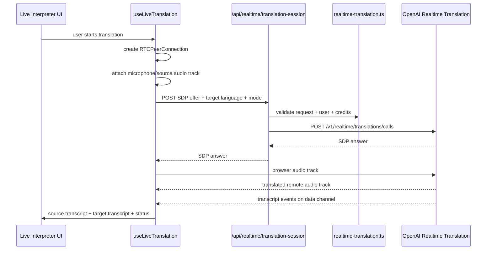

# OpenAI Realtime Translation Implementation Guide

Status: proposed implementation guide for AI coders and developers

Last updated: May 12, 2026

## Implementation Progress

Current code status as of May 12, 2026:

- Not implemented yet: dedicated realtime translation session route.
- Not implemented yet: browser hook for WebRTC translation rooms.
- Not implemented yet: Live Interpreter page/module.
- Not implemented yet: translation-specific credit metering.
- Not implemented yet: persisted translation session records and transcript artifacts.
- Not implemented yet: LINE/LIFF entry point for live interpretation.

This guide describes how Vaja should implement realtime speech-to-speech translation as a first-class product module called **Live Interpreter**. It is intentionally separate from Vaja's realtime voice-agent and realtime transcription flows.

Use this guide when building live interpretation, multilingual calls, listen-along translation, translated captions, or meeting/classroom/broadcast interpretation in Vaja.

## 1. Product Decision

Realtime translation belongs inside Vaja first, as a premium module:

```txt
Vaja Live Interpreter
```

Do not build it as a separate app initially. Vaja already owns:

- authenticated users and workspaces
- shared credit pools
- agents and skills
- LINE OA as the user front door
- web control room as the operator interface
- transcript persistence and knowledge workflows

Translation should become a specialized media feature inside that platform. If it later proves strong enough as a standalone buyer motion, it can be extracted into a focused product such as `Vaja Interpreter`.

## 2. Core UX

Vaja should expose three separate audio modes:

| UI control | User meaning | API/session | Output |
| --- | --- | --- | --- |
| Dictation | "Type what I say" | Realtime transcription | Editable composer text |
| Voice chat | "Talk with Vaja" | Realtime voice agent | Spoken assistant response with tools/skills |
| Live Interpreter | "Translate live speech" | Realtime translation | Translated audio plus source/target transcript |

Recommended labels:

- Composer dictation: `Dictate message`
- Voice assistant: `Talk with Vaja`
- Translation room: `Live Interpreter`
- Listen-along mode: `Translate a speaker`
- Conversation mode: `Two-way interpretation`

This split matters. Translation sessions are not assistant sessions. The model acts as an interpreter, not as a Vaja agent.

## 3. What Translation Sessions Are Not

Realtime translation must not be implemented as:

- a normal `streamText()` chat request
- a tool inside `buildToolSet()`
- a regular Vaja agent turn
- a `response.create` lifecycle
- a route that imports `features/tools/registry/server.ts`
- a client component that imports server business logic

OpenAI realtime translation uses the dedicated translation endpoint:

```txt
/v1/realtime/translations
```

The model to use for live speech translation is:

```txt
gpt-realtime-translate
```

Official model docs: `https://developers.openai.com/api/docs/models/gpt-realtime-translate`

As of the May 2026 docs, this model supports audio input/output plus transcript output, does not support function calling, and is priced by audio duration rather than normal text tokens. Keep pricing in config/admin copy, not hardcoded in business logic.

## 4. Vaja Use Cases

Prioritize these use cases:

| Use case | Product shape | First release? |
| --- | --- | --- |
| Thai/English meeting interpreter | Web translation room | Yes |
| Tutor/student language support | Web translation room | Yes |
| Sales/support call interpretation | Web room now, telephony later | Yes |
| Live webinar/listen-along captions | Listen-along room | Yes |
| LINE user joins interpreter room | LIFF or web link from LINE OA | Later in v1 |
| LINE voice-note translation | Request-based transcription/translation | Separate flow |
| SIP/Twilio/call-center bridge | Server WebSocket media worker | v2 |
| Multi-speaker group interpretation | Server media worker | v2 |

## 5. Architecture Overview

Start with browser WebRTC. It is the simplest and safest path because the browser captures microphone audio and plays translated audio as a remote track.



For server-side media, add WebSocket support later:

```txt
source audio -> media worker -> /v1/realtime/translations websocket -> translated audio/subtitles -> listeners
```

Do not mix browser WebRTC and server WebSocket implementation in the first PR unless the product requirement demands it.

## 6. Provider Strategy

Default translation model:

```txt
gpt-realtime-translate
```

Recommended environment variables:

```txt
OPENAI_REALTIME_TRANSLATION_MODEL=gpt-realtime-translate
OPENAI_REALTIME_TRANSLATION_DEFAULT_SOURCE_LANGUAGE=auto
OPENAI_REALTIME_TRANSLATION_DEFAULT_TARGET_LANGUAGE=th
OPENAI_REALTIME_TRANSLATION_MAX_SESSION_SECONDS=3600
OPENAI_REALTIME_TRANSLATION_CREDIT_MULTIPLIER=1
```

Recommended AI config slot to add later:

```txt
realtimeTranslationModel
```

Initial implementation can read the env var directly if the AI config system does not yet support this slot, but do not scatter the model string across routes/hooks.

## 7. File Map

### New Client Files

```txt
features/live-translation/hooks/use-live-translation.ts
```

Responsibilities:

- create and close `RTCPeerConnection`
- request microphone or screen/tab audio permission
- attach source audio track
- create/listen on the OpenAI data channel
- play remote translated audio track
- receive source transcript deltas
- receive target transcript deltas
- expose connection state, latency state, errors, and mute controls
- stop all tracks on close/unmount

```txt
features/live-translation/components/live-interpreter-page.tsx
```

Responsibilities:

- mode selector: listen-along vs two-way conversation
- source language selector, default `auto`
- target language selector, default from user/workspace preference
- start/stop controls
- source and target transcript panes
- original/translated audio volume controls
- session timer and estimated credit cost
- reconnecting/delayed/unavailable states

```txt
features/live-translation/components/language-select.tsx
features/live-translation/components/transcript-panel.tsx
features/live-translation/components/audio-level-meter.tsx
```

Keep these components presentation-only where possible.

### New Server Files

```txt
app/api/realtime/translation-session/route.ts
```

Responsibilities:

- require authenticated user
- validate request with Zod
- create a translation session with OpenAI
- send hashed `OpenAI-Safety-Identifier`
- return SDP answer to browser
- never expose `OPENAI_API_KEY`

```txt
features/live-translation/server/realtime-translation.ts
```

Responsibilities:

- define request/response schemas
- normalize source/target language settings
- validate supported modes
- hash user IDs for safety identifier
- build OpenAI session config
- estimate and finalize credit usage
- create/update persisted session records

```txt
features/live-translation/types.ts
features/live-translation/schema.ts
```

Use `schema.ts` for Zod schemas and `types.ts` for inferred/exported TypeScript types.

### New Route/Page

Recommended route:

```txt
app/(main)/live-interpreter/page.tsx
```

Add sidebar entry later:

```txt
features/chat/components/sidebar/sidebar-nav.tsx
```

Suggested nav item ID:

```ts
"live-interpreter"
```

## 8. Session Creation Contract

Client request:

```txt
POST /api/realtime/translation-session
```

Body:

```ts
{
  sdp: string;
  mode: "listen_along" | "conversation";
  sourceLanguage?: "auto" | string;
  targetLanguage: string;
  sourceLabel?: string;
  roomId?: string | null;
  threadId?: string | null;
  workspaceId?: string | null;
}
```

Response:

```txt
Content-Type: application/sdp
```

The body is the SDP answer returned by OpenAI.

Important server behavior:

- The route requires auth.
- The route checks that the user has enough credits to start a session.
- The route stores only metadata at session start.
- The route hashes the user ID before sending `OpenAI-Safety-Identifier`.
- The browser never receives the OpenAI API key.
- The browser receives only the SDP answer.

## 9. Zod Schemas

Create schemas in:

```txt
features/live-translation/schema.ts
```

Suggested starting point:

```ts
import { z } from "zod";

export const liveTranslationModeSchema = z.enum([
  "listen_along",
  "conversation",
]);

export const liveTranslationSessionRequestSchema = z.object({
  sdp: z.string().min(1),
  mode: liveTranslationModeSchema,
  sourceLanguage: z.string().min(2).max(16).optional().default("auto"),
  targetLanguage: z.string().min(2).max(16),
  sourceLabel: z.string().max(80).optional(),
  roomId: z.string().uuid().nullable().optional(),
  threadId: z.string().uuid().nullable().optional(),
  workspaceId: z.string().uuid().nullable().optional(),
});

export type LiveTranslationSessionRequest = z.infer<
  typeof liveTranslationSessionRequestSchema
>;
```

Keep this strict. Do not accept arbitrary session config from the client. The server owns provider configuration.

## 10. OpenAI WebRTC Session Route

The route should follow the same safety posture as the existing realtime voice/transcription routes:

```ts
import { NextRequest } from "next/server";
import { auth } from "@/lib/auth";
import {
  createOpenAITranslationSession,
  liveTranslationSessionRequestSchema,
} from "@/features/live-translation/server/realtime-translation";

export async function POST(req: NextRequest) {
  const session = await auth.api.getSession({ headers: req.headers });

  if (!session?.user) {
    return new Response("Unauthorized", { status: 401 });
  }

  const body = await req.json();
  const result = liveTranslationSessionRequestSchema.safeParse(body);

  if (!result.success) {
    return new Response("Bad Request", { status: 400 });
  }

  const sdpAnswer = await createOpenAITranslationSession({
    userId: session.user.id,
    input: result.data,
  });

  return new Response(sdpAnswer, {
    headers: { "Content-Type": "application/sdp" },
  });
}
```

The exact OpenAI calls endpoint path should be confirmed against current OpenAI docs during implementation. The stable architectural requirement is that this route targets the dedicated realtime translation API, not `/v1/realtime` voice-agent sessions.

## 11. Server Session Builder

Create:

```txt
features/live-translation/server/realtime-translation.ts
```

Responsibilities:

- read `OPENAI_API_KEY`
- read `OPENAI_REALTIME_TRANSLATION_MODEL`
- validate language settings
- create privacy-preserving safety identifier
- build provider request
- forward SDP offer to OpenAI
- return SDP answer

Skeleton:

```ts
import crypto from "node:crypto";
import {
  liveTranslationSessionRequestSchema,
  type LiveTranslationSessionRequest,
} from "@/features/live-translation/schema";

const DEFAULT_TRANSLATION_MODEL = "gpt-realtime-translate";

export { liveTranslationSessionRequestSchema };

export function hashSafetyIdentifier(userId: string): string {
  return crypto.createHash("sha256").update(userId).digest("hex");
}

export async function createOpenAITranslationSession({
  userId,
  input,
}: {
  userId: string;
  input: LiveTranslationSessionRequest;
}): Promise<string> {
  const apiKey = process.env.OPENAI_API_KEY;

  if (!apiKey) {
    throw new Error("OPENAI_API_KEY is not configured");
  }

  const model =
    process.env.OPENAI_REALTIME_TRANSLATION_MODEL ?? DEFAULT_TRANSLATION_MODEL;

  const res = await fetch(
    `https://api.openai.com/v1/realtime/translations/calls?model=${encodeURIComponent(
      model,
    )}`,
    {
      method: "POST",
      headers: {
        Authorization: `Bearer ${apiKey}`,
        "Content-Type": "application/sdp",
        "OpenAI-Safety-Identifier": hashSafetyIdentifier(userId),
      },
      body: input.sdp,
    },
  );

  if (!res.ok) {
    throw new Error(`Failed to create translation session: ${res.status}`);
  }

  return res.text();
}
```

During implementation, add the translation session config in the provider request according to the current OpenAI WebRTC translation docs. At minimum, configure:

- output target language
- source language if provided
- transcript output if configurable
- audio output format if configurable

If the current WebRTC translation call does not accept the language config in the SDP request, send a `session.update` event from the browser after the data channel opens:

```ts
dataChannel.send(
  JSON.stringify({
    type: "session.update",
    session: {
      audio: {
        output: {
          language: targetLanguage,
        },
      },
    },
  }),
);
```

Keep this event narrowly scoped. Do not allow the client to send arbitrary session settings through the server.

## 12. Client Hook

Create:

```txt
features/live-translation/hooks/use-live-translation.ts
```

Hook state:

```ts
type LiveTranslationStatus =
  | "idle"
  | "requesting_microphone"
  | "connecting"
  | "connected"
  | "reconnecting"
  | "stopping"
  | "error";
```

Hook API:

```ts
type UseLiveTranslationOptions = {
  mode: "listen_along" | "conversation";
  sourceLanguage?: string;
  targetLanguage: string;
  roomId?: string | null;
  threadId?: string | null;
  workspaceId?: string | null;
};

type UseLiveTranslationResult = {
  status: LiveTranslationStatus;
  sourceTranscript: string;
  targetTranscript: string;
  error: string | null;
  isMuted: boolean;
  start: () => Promise<void>;
  stop: () => void;
  setMuted: (muted: boolean) => void;
};
```

Client flow:

1. Request audio permission.
2. Create `RTCPeerConnection`.
3. Add local microphone or display-audio track.
4. Create data channel for OpenAI events if required by the WebRTC flow.
5. Create SDP offer.
6. POST offer to `/api/realtime/translation-session`.
7. Set remote SDP answer.
8. Send `session.update` with the target language if not configured server-side.
9. Play remote translated audio track.
10. Parse incoming transcript events.
11. Clean up tracks and peer connection on stop/unmount.

Important cleanup:

- stop every `MediaStreamTrack`
- close the data channel
- close the peer connection
- clear transcript event handlers
- do not keep audio capture alive after page navigation

## 13. Event Handling

Handle these event families from the translation session:

```txt
session.output_audio.delta
session.output_transcript.delta
session.input_transcript.delta
error
```

In WebRTC mode, audio should arrive as a remote media track. Transcript deltas should update UI state.

Recommended UI behavior:

- `input_transcript.delta` appends to the source transcript pane.
- `output_transcript.delta` appends to the translated transcript pane.
- translated audio plays by default.
- original audio can be muted/unmuted in listen-along mode.
- show "translation delayed" if transcript continues but audio stalls.

Do not call `response.create`. Translation starts from audio stream input.

## 14. Listen-Along Mode

Use listen-along when one speaker or source stream is translated for an audience.

Examples:

- webinar
- lecture
- livestream
- Thai/English conference talk
- recorded video playing in browser tab

Browser implementation:

- microphone input for live speaker
- optional `getDisplayMedia()` with tab audio for screen/video translation
- one translation session per target language

First release should support one target language per browser session:

```txt
English speaker -> Thai audio + Thai captions
```

Multi-target output can be added later:

```txt
English source -> Thai session
English source -> Japanese session
English source -> Vietnamese session
```

## 15. Conversation Mode

Use conversation mode when two people speak across languages.

For two-person translation, keep directions separate:

```txt
Person A audio -> translate to Person B language -> play to Person B
Person B audio -> translate to Person A language -> play to Person A
```

First release can use a guided push-to-talk UX:

- User selects `I speak Thai`.
- User selects `Other person speaks English`.
- User taps `Translate me` when speaking.
- User taps `Translate them` when the other person speaks.

This avoids multi-track complexity and speaker-overlap problems in v1.

Do not mix both speakers into one track and pretend it is solved. Mixed audio makes speaker identity, captions, overlap handling, and auditability worse.

## 16. LINE Integration

LINE OA should be an entry point, not the main realtime media transport for v1.

Recommended v1 LINE flows:

- Rich menu button: `Live Interpreter`
- LINE OA sends a LIFF/web link to `/live-interpreter`
- User opens authenticated web/LIFF room
- Session transcript can be sent back to LINE after completion if user opts in

Do not try to implement true realtime translation through normal LINE text messages.

For LINE voice notes, build a separate async flow:

```txt
LINE voice note -> download audio -> request transcription/translation -> reply with translated text
```

That is not the same as `gpt-realtime-translate`.

## 17. Skills Integration

Translation itself does not call tools or run agents, but Vaja skills still matter.

Recommended skill touchpoints:

- pre-session glossary: user selects an industry/domain skill
- custom vocabulary: names, products, brands, acronyms
- post-session summary: normal Vaja agent summarizes the stored transcript
- knowledge capture: save transcript to knowledge base or client workspace
- QA review: bilingual reviewer checks a golden set for high-stakes use cases

Do not inject full agent prompts into translation sessions unless OpenAI explicitly supports translation instructions for the current endpoint. Keep translation config focused and short.

Recommended first version:

- Allow optional `glossaryTerms` later, but do not include in v1 unless docs confirm supported behavior.
- After session ends, pass transcript to normal Vaja chat/agent flow for notes, action items, or follow-up content.

## 18. Persistence

Add persistence only after the WebRTC proof works. Do not let DB design block the first spike.

Recommended tables:

```txt
liveTranslationSession
liveTranslationTranscriptSegment
```

Suggested `liveTranslationSession` fields:

| Field | Purpose |
| --- | --- |
| `id` | session ID |
| `userId` | owner |
| `workspaceId` | optional workspace |
| `threadId` | optional related chat thread |
| `mode` | listen-along or conversation |
| `sourceLanguage` | auto/th/en/etc. |
| `targetLanguage` | th/en/etc. |
| `provider` | openai |
| `model` | gpt-realtime-translate or configured model |
| `status` | active/completed/failed/canceled |
| `startedAt` | session start |
| `endedAt` | session end |
| `durationSeconds` | billable duration estimate |
| `creditCost` | Vaja credits deducted |
| `errorMessage` | nullable failure detail |

Suggested `liveTranslationTranscriptSegment` fields:

| Field | Purpose |
| --- | --- |
| `id` | segment ID |
| `sessionId` | parent session |
| `speakerLabel` | optional speaker/source label |
| `kind` | source or target |
| `language` | language code |
| `text` | transcript segment |
| `startedAtMs` | optional media offset |
| `endedAtMs` | optional media offset |
| `createdAt` | DB timestamp |

Put schema in:

```txt
db/schema/live-translation.ts
```

If the project prefers grouping with chat/media tables later, create a small dedicated schema file first and refactor only if needed.

## 19. Credits And Billing

Realtime translation is duration-priced, so Vaja credits should be duration-based.

Recommended v1 approach:

- require a minimum credit balance before starting
- track session start time on server
- estimate running cost in UI
- finalize cost when session ends
- cap maximum session duration by env var
- fail closed if metering cannot complete

Suggested helper names:

```txt
reserveLiveTranslationCredits()
finalizeLiveTranslationCredits()
estimateLiveTranslationCreditCost()
```

Do not use text token accounting for translation sessions.

Credit edge cases:

- user closes tab without ending session
- WebRTC disconnects
- OpenAI session fails to start
- session exceeds max duration
- user balance becomes insufficient mid-session

For v1, enforce a max duration and finalize on best-effort heartbeat/end events.

## 20. Admin And Settings

Add admin settings after first working implementation:

- default target language
- enabled target languages
- max session length
- credit multiplier
- model ID
- feature flag: `liveInterpreterEnabled`
- whether transcript saving is on by default
- retention period for saved transcripts

Do not hardcode language availability in UI components. Keep a shared language list in the feature module or config.

## 21. Privacy And Consent

Live translation can capture other people's voices. Treat it as a high-consent feature.

Required UX:

- visible recording/translation indicator
- clear "Stop translation" button
- consent copy before first use
- transcript saving toggle
- delete transcript action
- warning when translating a meeting/call with other people

Required engineering behavior:

- never expose API keys in browser
- hash safety identifier
- stop microphone tracks on close
- do not save audio in v1
- save transcripts only when user/workspace setting allows it
- avoid logging raw transcript text in server logs

## 22. Quality Evaluation

Create a manual golden set before production launch.

Test:

- Thai to English
- English to Thai
- Thai/English code-switching
- names, phone numbers, dates, prices, addresses
- domain vocabulary from selected skill packages
- noisy room audio
- fast speech
- accents
- long pauses
- overlapping speech
- first-audio latency
- end-of-utterance latency
- transcript timing
- reconnect behavior

Recommended evaluation artifact:

```txt
docs/evals/live-translation-golden-set.md
```

For business-critical use cases, require bilingual review. Automated metrics will miss user-visible translation mistakes.

## 23. Testing Plan

Unit tests:

- request schema validation
- language normalization
- safety identifier hashing
- max duration/cost estimates
- OpenAI error mapping

Integration tests:

- unauthenticated request returns 401
- invalid request returns 400
- missing API key returns server error without leaking secrets
- successful route returns `application/sdp`
- route sends `OpenAI-Safety-Identifier`

Browser/manual tests:

- start/stop microphone
- remote translated audio plays
- source transcript appears
- target transcript appears
- cleanup stops browser mic indicator
- navigation away stops session
- reconnect/error state is visible

Do not rely only on mocked unit tests. Realtime media needs manual browser verification.

## 24. Rollout Plan

### Phase 0: Spike

- Add server route.
- Add minimal hook.
- Add temporary page under `/live-interpreter`.
- Verify WebRTC handshake and audio playback.
- Do not add DB persistence yet.

### Phase 1: Vaja Module

- Add polished Live Interpreter UI.
- Add language selectors.
- Add transcript panes.
- Add credit estimate.
- Add sidebar nav item.
- Add feature flag.

### Phase 2: Persistence

- Add DB tables.
- Save session metadata.
- Save transcript segments.
- Add transcript export/copy.
- Add "summarize with Vaja" action.

### Phase 3: LINE Entry Point

- Add LINE OA rich menu/action.
- Send LIFF/web link.
- Optionally send post-session transcript summary back to LINE.

### Phase 4: Server Media Worker

- Add WebSocket translation path.
- Support SIP/Twilio/broadcast ingest.
- Support multi-target language fanout.
- Support larger rooms with republished translated tracks.

## 25. AI Coder Rules

When implementing this feature:

- Use `pnpm`, never `npm` or `bun`.
- Keep translation separate from voice-agent and transcription routes.
- Do not import server services into client components.
- Do not put business logic in page components.
- Use Zod for every API request body.
- Keep `OPENAI_API_KEY` server-side only.
- Hash `OpenAI-Safety-Identifier`.
- Stop all media tracks on unmount.
- Do not call `response.create` in translation sessions.
- Do not add translation as a normal agent tool.
- Do not persist raw audio in v1.
- Do not skip manual browser testing.

## 26. Definition Of Done For V1

V1 is done when:

- authenticated user can open `/live-interpreter`
- user can select target language
- user can start a browser WebRTC translation session
- source audio streams to OpenAI through the dedicated translation endpoint
- translated audio plays in browser
- source transcript appears live
- target transcript appears live
- stop button closes session and microphone capture
- API key is never exposed to browser
- route uses hashed safety identifier
- UI has visible recording/translation state
- basic credit estimate is shown
- implementation is documented in this guide

V1 does not need:

- multi-speaker diarization
- multi-target output
- LINE realtime media transport
- SIP/Twilio integration
- transcript persistence
- glossary injection
- admin panel settings

## 27. Open Questions

Decide before production launch:

- Should transcript saving be opt-in per session or controlled by workspace policy?
- Should Live Interpreter be available to all users or only paid/workspace users?
- Which target languages are enabled at launch?
- What is the Vaja credit price per translated minute?
- Should Thai/English be the default pair?
- Should session transcripts be attachable to chat threads?
- Do we need a reviewer workflow for high-stakes domains such as legal, clinic, or education?
