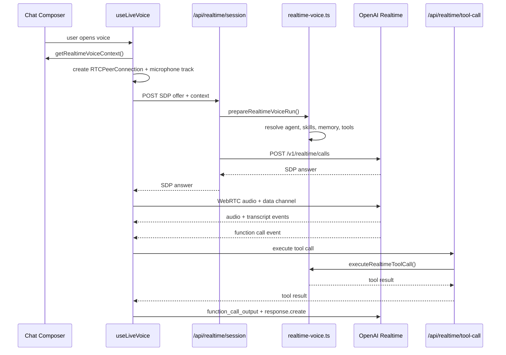

# OpenAI Realtime Voice Implementation Guide

Status: implementation guide for AI coders and developers

Progress as of 2026-05-11:

- Implemented OpenAI WebRTC realtime session creation through `app/api/realtime/session/route.ts`.
- Implemented canonical agent runtime reuse through `prepareRealtimeVoiceRun()` in `features/chat/server/realtime-voice.ts`.
- Implemented realtime tool execution through `app/api/realtime/tool-call/route.ts`.
- Implemented `buildRealtimeVoiceInstructions()` and replaced the earlier one-sentence realtime behavior suffix.
- Implemented `OPENAI_REALTIME_REASONING_EFFORT`, defaulting to `low`.
- Implemented realtime-only `wait_for_user` and client handling that does not force a follow-up spoken response.
- Implemented realtime tool-description wrapping for read/write/exact-identifier voice policies.
- Implemented voice-turn metadata persistence for provider, realtime model, activated skills, and tool-call summaries.
- Remaining work is tracked in section 20.

This guide explains the web realtime voice architecture in Vaja AI after moving the primary voice solution from Gemini Live to OpenAI Realtime. It is repo-specific and should be updated whenever the voice session contract, agent runtime, tool bridge, or provider selection changes.

## 1. Goal

Realtime voice should behave like the selected Vaja agent, not like a generic voice bot.

That means voice sessions must reuse the same core runtime concepts as text chat:

- selected agent system prompt
- attached skills
- skill-unlocked tools
- enabled agent tools
- selected knowledge documents
- user memory and thread working memory
- brand context
- persisted thread transcript

OpenAI is the main realtime voice provider. Gemini Live remains in the codebase as a fallback provider and should not be removed unless the product decision changes.

## 2. Provider Strategy

### Primary Provider

OpenAI Realtime over WebRTC is the primary web voice path.

Current default model:

```txt
gpt-realtime-2
```

Runtime override:

```txt
OPENAI_REALTIME_MODEL=gpt-realtime-2
OPENAI_REALTIME_VOICE=marin
OPENAI_REALTIME_TRANSCRIPTION_MODEL=gpt-realtime-whisper
OPENAI_REALTIME_REASONING_EFFORT=low
```

If `OPENAI_REALTIME_MODEL` is not set, the app defaults to `gpt-realtime-2`.

### Fallback Provider

Gemini Live remains available through the existing WebSocket implementation in:

```txt
features/chat/hooks/use-live-voice.ts
app/api/live-token/route.ts
```

Do not delete these paths when working on OpenAI voice. They are useful for rollback, comparison, and regions/accounts where OpenAI Realtime may not be enabled.

## 3. File Map

### Client

```txt
features/chat/hooks/use-live-voice.ts
```

Owns the browser voice lifecycle.

Responsibilities:

- default to the OpenAI provider
- create a WebRTC peer connection
- attach microphone audio
- play remote assistant audio
- listen to OpenAI realtime events on the `oai-events` data channel
- stream transcripts into the composer voice UI
- execute realtime function calls through the server bridge
- preserve the existing Gemini WebSocket path

```txt
features/chat/components/composer/chat-composer.tsx
```

Passes realtime session context into the hook.

```txt
app/page.tsx
```

Builds the realtime context from current chat state:

- thread ID
- selected agent ID
- selected model
- enabled model IDs
- selected document IDs
- web-search toggle

### Server

```txt
app/api/realtime/session/route.ts
```

Creates an OpenAI WebRTC realtime session. The browser sends an SDP offer, and this route forwards it to OpenAI with the server-built session configuration.

```txt
app/api/realtime/tool-call/route.ts
```

Executes OpenAI realtime function calls through Vaja's server-side tool runtime.

```txt
features/chat/server/realtime-voice.ts
```

Shared server runtime for realtime voice.

Responsibilities:

- validate realtime voice context
- verify thread ownership
- resolve the selected/default agent
- prepare the canonical agent run
- build OpenAI realtime function tool schemas from the AI SDK `ToolSet`
- execute a realtime tool call using the same tool implementations as text chat

```txt
features/skills/server/activation.ts
features/skills/service.ts
```

Adds `resolveRealtimeVoiceSkillRuntimeContext()`, which prepares attached skills for a live voice session.

## 4. OpenAI WebRTC Flow

The high-level flow is:



## 5. Session Creation Contract

Client request to:

```txt
POST /api/realtime/session
```

Body:

```ts
{
  sdp: string;
  threadId: string;
  agentId?: string | null;
  model?: string;
  enabledModelIds?: string[];
  selectedDocumentIds?: string[];
  useWebSearch?: boolean;
  voiceName?: string | null;
  history?: Array<{
    role: "user" | "assistant";
    text: string;
  }>;
}
```

Response:

```txt
Content-Type: application/sdp
```

The response body is the SDP answer returned by OpenAI.

Important server behavior:

- The route requires an authenticated user.
- The route verifies that `threadId` belongs to the user.
- The server hashes the user ID before sending `OpenAI-Safety-Identifier`.
- The browser never receives the OpenAI API key.

## 6. Agent Runtime Reuse

Realtime voice uses:

```ts
prepareAgentRun()
```

from:

```txt
features/agents/server/run-service.ts
```

This is intentional. Do not build a separate voice-only agent prompt stack.

The realtime path should continue to reuse canonical agent preparation because that is where Vaja resolves:

- active agent
- brand runtime
- memory context
- document grounding
- tool IDs
- skill tool IDs
- actual tool set
- final system prompt

If future work needs more voice-specific behavior, add it as an extra prompt block or a channel-specific option around `prepareAgentRun()`, not as a duplicate runtime.

## 7. Skills In Voice

Text chat activates skills after seeing the user's latest message. Realtime voice is different: the session starts before the first spoken user message exists.

Current voice behavior:

- attached agent skills are loaded at session start
- available skill catalog is injected
- attached skill instructions are injected
- skill resources are selected against a generic voice prompt
- skill-enabled tools are merged into the active tool set

Function:

```ts
resolveRealtimeVoiceSkillRuntimeContext(skills)
```

Location:

```txt
features/skills/server/activation.ts
```

Why this design:

- avoids a slow round trip before the first spoken turn
- lets always-attached agent skills shape the voice behavior immediately
- keeps skill-unlocked tools available during the session

Known limitation:

- model-discovered skills based on the exact spoken message are not dynamically re-scored mid-session yet

Future enhancement:

- listen for completed input transcription
- call skill discovery with the transcript
- send `session.update` with refreshed instructions/tools
- keep this incremental and debounce updates to avoid unstable prompt churn

## 8. Tools In Voice

OpenAI Realtime function tools are generated from the prepared AI SDK `ToolSet`.

Key function:

```ts
buildRealtimeFunctionTools(tools)
```

Location:

```txt
features/chat/server/realtime-voice.ts
```

Realtime tool call flow:

1. OpenAI emits `response.function_call_arguments.done`.
2. The client posts the call to `/api/realtime/tool-call`.
3. The server rebuilds the prepared realtime voice run from the same context.
4. The server finds the named tool in `preparedRun.tools`.
5. The tool executes on the server.
6. The client sends `conversation.item.create` with `function_call_output`.
7. The client sends `response.create` so the model can continue.

This preserves the core rule from `AGENTS.md`:

> Every tool must have one canonical `service.ts`. Agent adapter, API route, and sidebar page all call that service.

Do not implement tool business logic inside the realtime route or the client hook.

## 9. Gemini Fallback Path

The existing Gemini path remains in:

```txt
features/chat/hooks/use-live-voice.ts
app/api/live-token/route.ts
```

The hook supports:

```ts
provider?: "openai" | "gemini";
```

Default:

```ts
provider = "openai";
```

To force Gemini from a caller:

```tsx
useLiveVoice({
  enabled,
  provider: "gemini",
  voiceName,
  onTurnComplete,
  history,
});
```

Do not route OpenAI through `/api/live-token`; that endpoint is Gemini-specific.

## 10. Persistence

Voice turns are still persisted by:

```txt
app/api/voice-turn/route.ts
```

Current behavior:

- inserts the user transcript as a user message
- inserts the assistant transcript as an assistant message
- marks message metadata as `{ source: "voice" }`
- when available, stores voice metadata under `metadata.voice`
- updates the thread preview and timestamp

Persisted voice metadata shape:

```ts
{
  source: "voice",
  voice: {
    provider: "openai" | "gemini",
    realtimeModel?: string,
    activatedSkills?: Array<{
      id: string;
      name: string;
      source: "rule" | "model";
    }>,
    toolCalls?: Array<{
      name: string;
      callId?: string;
      ok: boolean;
      durationMs?: number;
      error?: string;
    }>,
  },
}
```

Current implementation notes:

- `/api/realtime/session` returns `X-Vaja-Realtime-Model` and `X-Vaja-Realtime-Activated-Skills` response headers.
- `use-live-voice.ts` tracks OpenAI realtime tool-call summaries per completed turn.
- `/api/voice-turn` validates metadata with Zod before inserting messages.
- Tool arguments are intentionally not persisted in metadata.

Future improvement:

- include audio-specific usage when available

Keep persistence separate from the realtime transport. The transport should not write directly to the DB from the browser.

## 11. Environment Variables

Required:

```txt
OPENAI_API_KEY
```

Recommended:

```txt
OPENAI_REALTIME_MODEL=gpt-realtime-2
OPENAI_REALTIME_VOICE=marin
OPENAI_REALTIME_TRANSCRIPTION_MODEL=gpt-realtime-whisper
```

Existing Gemini fallback:

```txt
GEMINI_API_KEY
GEMINI_LIVE_MODEL=gemini-3.1-flash-live-preview
```

Never expose API keys to the client. OpenAI realtime session creation must remain server-side.

## 12. Developer Checklist

When changing realtime voice:

- Keep OpenAI as the default unless product explicitly decides otherwise.
- Keep Gemini fallback unless product explicitly removes it.
- Run `pnpm exec tsc --noEmit`.
- Test with a selected agent that has attached skills.
- Test with a tool-enabled agent.
- Test with selected knowledge documents.
- Test that closing the voice session stops the microphone.
- Test mute/unmute behavior.
- Test a Thai spoken turn and an English spoken turn.
- Do not put tool business logic in `use-live-voice.ts`.
- Do not send `OPENAI_API_KEY` to the browser.
- Do not bypass `prepareAgentRun()` for agent voice behavior.

## 13. Common Failure Modes

### Realtime session fails immediately

Check:

- `OPENAI_API_KEY` exists
- `OPENAI_REALTIME_MODEL` is available to the account
- `/api/realtime/session` returns an SDP answer, not JSON
- browser microphone permission is granted

### The assistant speaks but does not use the selected agent

Check:

- `getRealtimeVoiceContext()` passes `agentId`
- `prepareRealtimeVoiceRun()` resolves the active agent
- `preparedRun.systemPrompt` is used as `session.instructions`

### Tools are listed but tool calls fail

Check:

- tool has an `execute` function
- tool input schema converts through `asSchema(tool.inputSchema).jsonSchema`
- `/api/realtime/tool-call` receives the same context used for session creation
- tool is enabled by agent settings or skill-unlocked tools

### Skills do not seem active

Check:

- selected agent has skill attachments
- `getSkillsForAgent(activeAgent.id)` returns skills
- `resolveRealtimeVoiceSkillRuntimeContext()` is called
- `skillRuntimeOverride` reaches `prepareAgentRun()`

### Duplicate or missing persisted voice turns

Check:

- OpenAI transcript events are completing
- `onVoiceTurnComplete` fires once per completed assistant answer
- `/api/voice-turn` receives both `userText` and `aiText`

## 14. Future Work

Recommended next steps:

- Add a visible voice provider/debug indicator in development.
- Store provider/model/tool metadata in voice message metadata.
- Add dynamic skill re-scoring after completed user transcription.
- Add realtime usage/credit accounting once OpenAI exposes reliable per-session usage for this flow.
- Add integration tests for `/api/realtime/session` shape with mocked OpenAI responses.
- Add a provider setting in admin AI config so operations can switch between OpenAI and Gemini without code changes.

## 15. Optimizing For `gpt-realtime-2`

`gpt-realtime-2` should be treated as a reasoning voice agent, not just a speech wrapper around text chat. It can reason before speaking, follow precise tool policies, maintain longer context, and handle more complex instructions than earlier realtime models.

The goal in Vaja is not to make every agent prompt longer. The goal is:

- keep the selected agent prompt as the domain brain
- keep skills as the domain specialization layer
- keep tools as canonical server-side capabilities
- add one compact realtime voice overlay that controls speech behavior, ambiguity, confirmation, and tool timing

Do not over-prompt upfront. Start with the compact overlay below, run voice evals, and add instructions only for behaviors that fail.

### Recommended Session Settings

Start with low reasoning effort:

```ts
reasoning: {
  effort: "low",
}
```

Recommended env var:

```txt
OPENAI_REALTIME_REASONING_EFFORT=low
```

Reasoning-effort guidance:

- `minimal`: use for very simple command-style agents where latency matters most
- `low`: default for most Vaja agents
- `medium`: use for diagnostics, planning, policy interpretation, complex tool selection, or high-ambiguity workflows
- `high`: reserve for high-precision workflows where added latency is acceptable
- `xhigh`: avoid by default; only use for exceptional planning or critical triage scenarios

Do not default to `high`. Voice latency is part of product quality.

### Compact Vaja Voice Overlay

Append a short voice-specific block after `preparedRun.systemPrompt` when creating the OpenAI realtime session.

Recommended shape:

```txt
# Realtime Voice Behavior

## Objective

You are speaking as the selected Vaja agent. Use the agent instructions, active skills, memory, brand context, and available tools to help the user by voice.

## Language

- Respond in Thai when the user clearly speaks Thai.
- Respond in English when the user clearly speaks English.
- Do not switch language based on accent alone.
- Ignore short filler sounds, backchannels, names, addresses, and isolated foreign words for language switching.
- If language is unclear, ask one short clarification.
- Keep preambles, tool updates, and final answers in the same language as the user.

## Verbosity

- Direct answers: use 1-2 short sentences.
- Clarifying questions: ask one question at a time.
- Tool results: summarize the result first, then give only the next useful action.
- Troubleshooting: give one step at a time unless the user asks for the full procedure.
- Escalation: briefly explain why escalation is needed and what will happen next.

## Preambles

Use a short preamble only when it helps the user understand that work is happening.

Use a preamble before slower tool calls, multi-step reasoning, record checks, policy checks, or escalation preparation.

Do not use a preamble for direct answers, simple confirmations, unclear audio, silence, background noise, or lightweight tool calls.

When using a preamble, use one short natural sentence. Describe the action, not private reasoning.

Good examples:

- "I'll check that now."
- "I'll verify that before we make any changes."
- "I'll pull that up so we use the right record."

Avoid:

- "Let me think."
- "Please wait while I process that."
- "I'm going to use my tools now."

## Tools

Use only the tools explicitly provided in the current tool list. Do not invent, rename, simulate, or assume tools.

For read-only tools:

- Call the tool when the user's intent is clear and all required fields are available.
- Do not ask for confirmation unless the lookup depends on a high-precision identifier or there is meaningful risk of using the wrong record.
- Ask a clarification question only if a required field is missing, ambiguous, or conflicting.

For write tools or external actions:

- Summarize the intended action before calling the tool.
- Include the key consequence: what will be changed, sent, canceled, ordered, charged, saved, or published.
- Ask for confirmation.
- Do not call the tool until the user clearly confirms.

After tool calls:

- Only say an action was completed after the tool succeeds.
- If the tool fails, explain the failure briefly, avoid raw errors, and give one clear next step.
- Do not repeatedly call the same tool with the same arguments after failure.

## Unclear Audio

- Only act on clear audio or text.
- If the user's audio is unclear, noisy, silent, partially cut off, or ambiguous, ask one short clarification.
- Do not guess missing words.
- Do not call tools from unclear audio.
- Do not use a preamble when asking for unclear-audio clarification.

## Exact Entity Capture

Treat order IDs, tracking numbers, account numbers, confirmation codes, phone numbers, email addresses, ticket IDs, claim IDs, and similar values as high precision.

- Collect one exact value at a time.
- Normalize only what is clear.
- Preserve explicitly spoken separators like dash, dot, underscore, slash, and plus.
- Confirm the final normalized value before account-specific lookups, validation, write actions, or external actions.
- Read numeric identifiers back digit by digit.
- Ask users to spell email addresses character by character when precision matters.
- If the user corrects any part of the value, repeat the full corrected value and ask for confirmation again.

Never call tools with guessed, partial, ambiguous, or unconfirmed exact values.

## Silence and Background Audio

If the latest audio is silence, background noise, hold music, TV audio, side conversation, or speech not addressed to you, call `wait_for_user` if it is available.

Do not say "I'm here," "I didn't catch that," "Take your time," or "Let me know when you're ready" after calling `wait_for_user`.

Resume normal responses only when the user clearly addresses you or asks for help.
```

Implementation target:

```txt
features/chat/server/realtime-voice.ts
```

Recommended helper:

```ts
buildRealtimeVoiceInstructions()
```

The route should compose:

```ts
instructions: [
  preparedRun.systemPrompt,
  buildRealtimeVoiceInstructions(),
].filter(Boolean).join("\n\n")
```

## 16. Voice-Specific Tool Policy

The existing AI SDK tool descriptions were mostly written for text chat. Realtime voice benefits from tool descriptions that are explicit about when to act, when to ask, and when to confirm.

When wrapping tools for realtime, preserve the canonical tool name and schema, but enrich descriptions with voice policy.

Recommended description structure:

```txt
Use when:
- [clear trigger]

Do not use when:
- [clear exception]

Voice behavior:
- [whether to call immediately, use a preamble, ask a clarification, or confirm first]

Failure handling:
- [what to say if the tool fails]
```

Default policy:

- Read-only low-risk tools: proactive
- Read-only tools with exact identifiers: confirm identifier first
- User-visible communication tools: draft or summarize before sending
- Data-changing tools: confirm first
- Purchases, payments, cancellations, publishing, and irreversible actions: confirm target, amount/content, and consequence before calling

Do not add business logic to descriptions. Descriptions guide model behavior; canonical execution still belongs in each tool's `service.ts`.

## 17. `wait_for_user` Tool

Add a no-op realtime tool so the model has a valid non-speaking action for silence or background audio.

Recommended OpenAI realtime tool:

```json
{
  "type": "function",
  "name": "wait_for_user",
  "description": "Call this when the latest audio does not need a spoken response, such as silence, background noise, hold music, TV audio, side conversation, or speech not addressed to the assistant. This tool ends the turn without a spoken reply.",
  "parameters": {
    "type": "object",
    "properties": {},
    "required": []
  }
}
```

Server behavior:

- Return `{ "ok": true }`.
- Do not persist a chat message for `wait_for_user`.
- Do not trigger a follow-up `response.create` that makes the model speak.
- Current implementation handles this in `executeRealtimeToolCall()` before rebuilding the full prepared agent run.

Client behavior:

- If `wait_for_user` is called, send the function output back to OpenAI.
- Do not force a new assistant response after this tool.
- Keep listening.
- Current implementation clears the partial silent/background turn and returns to `listening`.

This should be implemented as a realtime-only helper tool unless the product also needs it in normal text chat.

## 18. Realtime Evals

Before adding more prompt instructions, run representative voice evals. The first eval suite should be small and practical.

Core eval cases:

- Thai direct answer: user asks a simple Thai question; assistant answers in Thai within 1-2 short sentences.
- English direct answer: user asks a simple English question; assistant answers in English without switching language based on accent.
- Unclear Thai audio: assistant asks one short clarification and does not call tools.
- Background audio: assistant calls `wait_for_user` and does not speak.
- Read-only tool: user asks for a low-risk lookup with all required fields; assistant calls the tool without unnecessary confirmation.
- Exact identifier lookup: user gives a phone number or order ID; assistant confirms the normalized value before calling the tool.
- Write action: user asks to save, send, publish, cancel, charge, or update something; assistant summarizes consequence and asks for confirmation before calling the tool.
- Tool failure: tool fails once; assistant explains briefly and offers one clear next step without raw error output.
- Skill behavior: selected agent has an attached skill; assistant follows the skill in voice.
- Long-session context: assistant respects current state over stale history.

Track at least:

- language correctness
- latency perception
- preamble appropriateness
- tool-call correctness
- confirmation correctness
- unclear-audio behavior
- whether the answer sounds natural by voice

Only add new prompt rules for repeated failures. Avoid stacking broad `always`, `never`, `only`, and `must` rules unless the behavior is truly required.

## 19. Prompt Anti-Patterns

Avoid these in Vaja realtime prompts:

- "Always ask for confirmation before doing anything."
- "Always use tools when possible."
- "Mirror the user."
- "Respond naturally in the user's language" without defining language switching.
- "Use the order tool" when no such tool exists in the actual tool list.
- Long generic customer-service scripts injected into every agent.
- Repeating the same rule in both agent prompt, skill prompt, and realtime overlay with slightly different wording.
- Asking the model to reveal hidden reasoning.

Prefer scoped instructions:

- "For write actions that modify user data, ask for confirmation before calling the tool."
- "For clear read-only lookups, call the tool when required fields are available."
- "If audio is unclear, ask for clarification instead of guessing or calling tools."

## 20. Implementation Backlog

Current progress:

- Done: Add `buildRealtimeVoiceInstructions()` and replace the current one-sentence realtime behavior suffix.
- Done: Add `OPENAI_REALTIME_REASONING_EFFORT`, defaulting to `low`.
- Done: Add realtime-only `wait_for_user`.
- Done: Add realtime tool-description wrapping for read/write/identifier policies.
- Done: Persist voice metadata: provider, realtime model, activated skills, and tool calls.

Remaining implementation order:

1. Add dynamic skill re-scoring after completed user transcription.
2. Add mocked integration tests for `/api/realtime/session` and `/api/realtime/tool-call`.
3. Add a small manual eval checklist or scripted eval harness for the cases in section 18.
