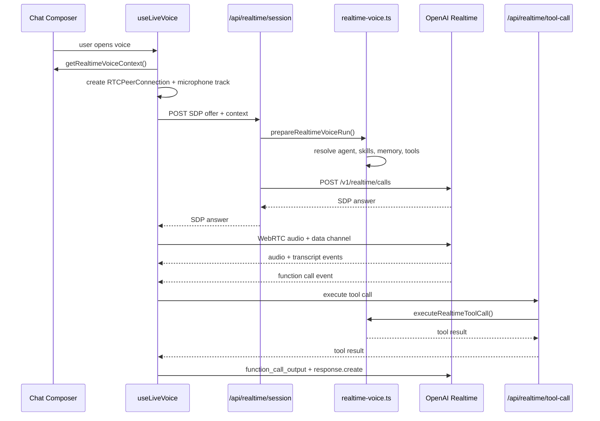

# OpenAI Realtime Voice Implementation Guide

Status: implementation guide for AI coders and developers

This guide explains the web realtime voice architecture in Vaja AI after moving the primary voice solution from Gemini Live to OpenAI Realtime. It is repo-specific and should be updated whenever the voice session contract, agent runtime, tool bridge, or provider selection changes.

## 1. Goal

Realtime voice should behave like the selected Vaja agent, not like a generic voice bot.

That means voice sessions must reuse the same core runtime concepts as text chat:

- selected agent system prompt
- attached skills
- skill-unlocked tools
- enabled agent tools
- selected knowledge documents
- user memory and thread working memory
- brand context
- persisted thread transcript

OpenAI is the main realtime voice provider. Gemini Live remains in the codebase as a fallback provider and should not be removed unless the product decision changes.

## 2. Provider Strategy

### Primary Provider

OpenAI Realtime over WebRTC is the primary web voice path.

Current default model:

```txt
gpt-realtime-2
```

Runtime override:

```txt
OPENAI_REALTIME_MODEL=gpt-realtime-2
OPENAI_REALTIME_VOICE=marin
OPENAI_REALTIME_TRANSCRIPTION_MODEL=gpt-4o-mini-transcribe
```

If `OPENAI_REALTIME_MODEL` is not set, the app defaults to `gpt-realtime-2`.

### Fallback Provider

Gemini Live remains available through the existing WebSocket implementation in:

```txt
features/chat/hooks/use-live-voice.ts
app/api/live-token/route.ts
```

Do not delete these paths when working on OpenAI voice. They are useful for rollback, comparison, and regions/accounts where OpenAI Realtime may not be enabled.

## 3. File Map

### Client

```txt
features/chat/hooks/use-live-voice.ts
```

Owns the browser voice lifecycle.

Responsibilities:

- default to the OpenAI provider
- create a WebRTC peer connection
- attach microphone audio
- play remote assistant audio
- listen to OpenAI realtime events on the `oai-events` data channel
- stream transcripts into the composer voice UI
- execute realtime function calls through the server bridge
- preserve the existing Gemini WebSocket path

```txt
features/chat/components/composer/chat-composer.tsx
```

Passes realtime session context into the hook.

```txt
app/page.tsx
```

Builds the realtime context from current chat state:

- thread ID
- selected agent ID
- selected model
- enabled model IDs
- selected document IDs
- web-search toggle

### Server

```txt
app/api/realtime/session/route.ts
```

Creates an OpenAI WebRTC realtime session. The browser sends an SDP offer, and this route forwards it to OpenAI with the server-built session configuration.

```txt
app/api/realtime/tool-call/route.ts
```

Executes OpenAI realtime function calls through Vaja's server-side tool runtime.

```txt
features/chat/server/realtime-voice.ts
```

Shared server runtime for realtime voice.

Responsibilities:

- validate realtime voice context
- verify thread ownership
- resolve the selected/default agent
- prepare the canonical agent run
- build OpenAI realtime function tool schemas from the AI SDK `ToolSet`
- execute a realtime tool call using the same tool implementations as text chat

```txt
features/skills/server/activation.ts
features/skills/service.ts
```

Adds `resolveRealtimeVoiceSkillRuntimeContext()`, which prepares attached skills for a live voice session.

## 4. OpenAI WebRTC Flow

The high-level flow is:



## 5. Session Creation Contract

Client request to:

```txt
POST /api/realtime/session
```

Body:

```ts
{
  sdp: string;
  threadId: string;
  agentId?: string | null;
  model?: string;
  enabledModelIds?: string[];
  selectedDocumentIds?: string[];
  useWebSearch?: boolean;
  voiceName?: string | null;
  history?: Array<{
    role: "user" | "assistant";
    text: string;
  }>;
}
```

Response:

```txt
Content-Type: application/sdp
```

The response body is the SDP answer returned by OpenAI.

Important server behavior:

- The route requires an authenticated user.
- The route verifies that `threadId` belongs to the user.
- The server hashes the user ID before sending `OpenAI-Safety-Identifier`.
- The browser never receives the OpenAI API key.

## 6. Agent Runtime Reuse

Realtime voice uses:

```ts
prepareAgentRun()
```

from:

```txt
features/agents/server/run-service.ts
```

This is intentional. Do not build a separate voice-only agent prompt stack.

The realtime path should continue to reuse canonical agent preparation because that is where Vaja resolves:

- active agent
- brand runtime
- memory context
- document grounding
- tool IDs
- skill tool IDs
- actual tool set
- final system prompt

If future work needs more voice-specific behavior, add it as an extra prompt block or a channel-specific option around `prepareAgentRun()`, not as a duplicate runtime.

## 7. Skills In Voice

Text chat activates skills after seeing the user's latest message. Realtime voice is different: the session starts before the first spoken user message exists.

Current voice behavior:

- attached agent skills are loaded at session start
- available skill catalog is injected
- attached skill instructions are injected
- skill resources are selected against a generic voice prompt
- skill-enabled tools are merged into the active tool set

Function:

```ts
resolveRealtimeVoiceSkillRuntimeContext(skills)
```

Location:

```txt
features/skills/server/activation.ts
```

Why this design:

- avoids a slow round trip before the first spoken turn
- lets always-attached agent skills shape the voice behavior immediately
- keeps skill-unlocked tools available during the session

Known limitation:

- model-discovered skills based on the exact spoken message are not dynamically re-scored mid-session yet

Future enhancement:

- listen for completed input transcription
- call skill discovery with the transcript
- send `session.update` with refreshed instructions/tools
- keep this incremental and debounce updates to avoid unstable prompt churn

## 8. Tools In Voice

OpenAI Realtime function tools are generated from the prepared AI SDK `ToolSet`.

Key function:

```ts
buildRealtimeFunctionTools(tools)
```

Location:

```txt
features/chat/server/realtime-voice.ts
```

Realtime tool call flow:

1. OpenAI emits `response.function_call_arguments.done`.
2. The client posts the call to `/api/realtime/tool-call`.
3. The server rebuilds the prepared realtime voice run from the same context.
4. The server finds the named tool in `preparedRun.tools`.
5. The tool executes on the server.
6. The client sends `conversation.item.create` with `function_call_output`.
7. The client sends `response.create` so the model can continue.

This preserves the core rule from `AGENTS.md`:

> Every tool must have one canonical `service.ts`. Agent adapter, API route, and sidebar page all call that service.

Do not implement tool business logic inside the realtime route or the client hook.

## 9. Gemini Fallback Path

The existing Gemini path remains in:

```txt
features/chat/hooks/use-live-voice.ts
app/api/live-token/route.ts
```

The hook supports:

```ts
provider?: "openai" | "gemini";
```

Default:

```ts
provider = "openai";
```

To force Gemini from a caller:

```tsx
useLiveVoice({
  enabled,
  provider: "gemini",
  voiceName,
  onTurnComplete,
  history,
});
```

Do not route OpenAI through `/api/live-token`; that endpoint is Gemini-specific.

## 10. Persistence

Voice turns are still persisted by:

```txt
app/api/voice-turn/route.ts
```

Current behavior:

- inserts the user transcript as a user message
- inserts the assistant transcript as an assistant message
- marks message metadata as `{ source: "voice" }`
- updates the thread preview and timestamp

Future improvement:

- include provider metadata: `provider: "openai"`
- include realtime model ID
- include activated skill IDs/names
- include tool-call count and tool names
- include audio-specific usage when available

Keep persistence separate from the realtime transport. The transport should not write directly to the DB from the browser.

## 11. Environment Variables

Required:

```txt
OPENAI_API_KEY
```

Recommended:

```txt
OPENAI_REALTIME_MODEL=gpt-realtime-2
OPENAI_REALTIME_VOICE=marin
OPENAI_REALTIME_TRANSCRIPTION_MODEL=gpt-4o-mini-transcribe
```

Existing Gemini fallback:

```txt
GEMINI_API_KEY
GEMINI_LIVE_MODEL=gemini-3.1-flash-live-preview
```

Never expose API keys to the client. OpenAI realtime session creation must remain server-side.

## 12. Developer Checklist

When changing realtime voice:

- Keep OpenAI as the default unless product explicitly decides otherwise.
- Keep Gemini fallback unless product explicitly removes it.
- Run `pnpm exec tsc --noEmit`.
- Test with a selected agent that has attached skills.
- Test with a tool-enabled agent.
- Test with selected knowledge documents.
- Test that closing the voice session stops the microphone.
- Test mute/unmute behavior.
- Test a Thai spoken turn and an English spoken turn.
- Do not put tool business logic in `use-live-voice.ts`.
- Do not send `OPENAI_API_KEY` to the browser.
- Do not bypass `prepareAgentRun()` for agent voice behavior.

## 13. Common Failure Modes

### Realtime session fails immediately

Check:

- `OPENAI_API_KEY` exists
- `OPENAI_REALTIME_MODEL` is available to the account
- `/api/realtime/session` returns an SDP answer, not JSON
- browser microphone permission is granted

### The assistant speaks but does not use the selected agent

Check:

- `getRealtimeVoiceContext()` passes `agentId`
- `prepareRealtimeVoiceRun()` resolves the active agent
- `preparedRun.systemPrompt` is used as `session.instructions`

### Tools are listed but tool calls fail

Check:

- tool has an `execute` function
- tool input schema converts through `asSchema(tool.inputSchema).jsonSchema`
- `/api/realtime/tool-call` receives the same context used for session creation
- tool is enabled by agent settings or skill-unlocked tools

### Skills do not seem active

Check:

- selected agent has skill attachments
- `getSkillsForAgent(activeAgent.id)` returns skills
- `resolveRealtimeVoiceSkillRuntimeContext()` is called
- `skillRuntimeOverride` reaches `prepareAgentRun()`

### Duplicate or missing persisted voice turns

Check:

- OpenAI transcript events are completing
- `onVoiceTurnComplete` fires once per completed assistant answer
- `/api/voice-turn` receives both `userText` and `aiText`

## 14. Future Work

Recommended next steps:

- Add a visible voice provider/debug indicator in development.
- Store provider/model/tool metadata in voice message metadata.
- Add dynamic skill re-scoring after completed user transcription.
- Add realtime usage/credit accounting once OpenAI exposes reliable per-session usage for this flow.
- Add integration tests for `/api/realtime/session` shape with mocked OpenAI responses.
- Add a provider setting in admin AI config so operations can switch between OpenAI and Gemini without code changes.

